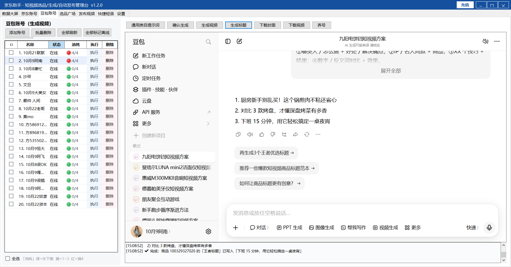

# 京东 AI 短视频带货与佣金实战

JD AI Video Affiliate · 京东联盟推广 · 豆包 AI 视频生成 · 选品挂品 · 佣金案例

**案例录屏：近 30 天预估收入 ¥32,307.64**

**近 30 天有效订单金额超过 105 万元，1,592 笔有效订单，页面显示预估收入 ¥32,307.64。**

这是本项目所附佣金录屏中展示的一组数据。项目围绕京东商品带货，使用 AI 辅助制作短视频，并通过软件集中管理选品、内容生成和发布流程，让从商品到视频的操作路径更清楚、更便于重复执行。

本项目整理京东 AI 短视频带货教程、豆包视频生成思路、选品挂品流程、多账号管理界面和佣金案例，帮助新手了解从内容制作到联盟推广的完整业务路径。

## 先看收入与成交数据

| 核心指标 | 录屏展示数据 |
| --- | ---: |
| **近 30 天预估收入** | **¥32,307.64** |
| **近 7 天预估收入** | **¥17,867.29** |
| **昨天预估收入** | **¥3,608.40** |
| **今天预估收入（刷新后）** | **¥2,356.40** |
| **近 30 天有效订单金额** | **¥1,052,748.60** |
| **近 30 天有效订单量** | **1,592 笔** |

[查看佣金页面原始录屏](realdata.mp4)

以上为单份录屏展示的历史页面数据，预估收入不等于已结算收入或净利润，也不代表每位参与者的结果。录屏未展示收入来源明细，尚无法确认全部收入均来自 AI 短视频；完整口径见下方“佣金数据录屏”。

## 从选品到挂品，把创作流程串起来

**选好商品，用 AI 辅助生成脚本与视频，完成标题、封面和商品核对后发布挂品。** 现有资料将这条路径拆成新手可学习的操作步骤，并提供服装、大物件和通用品类的脚本参考。

- **新手有路径**：从实名认证、账号准备到发布挂品，课件逐步说明。
- **创作有参考**：围绕约 15 秒竖版视频，提供镜头、动作和口播脚本思路。
- **多账号集中管理**：软件截图展示 20 个豆包账号及在线状态、消耗计数和执行入口。
- **素材生成集中操作**：同一界面提供生成视频、生成标题、下载封面与下载视频入口。
- **发布前有检查依据**：整理货品一致性、画面质量、标题口播和审核相关要点。

本仓库可用于了解项目模式、学习操作流程，以及讨论后续软件需求。

当前仓库包含两份课件、一张软件截图和一段佣金数据录屏，尚未包含软件源码、安装包或可运行的自动化脚本。本文描述的软件功能来自截图，未进行实际运行验证。

## 项目资料

| 文件 | 内容与用途 |
| --- | --- |
| [AI短视频带货新手学员培训课件.docx](AI短视频带货新手学员培训课件.docx) | 新手操作指南，包含应用安装、实名认证、创作者平台设置、豆包提示词和视频教程入口 |
| [京东优质AI短视频带货全要点.pptx](京东优质AI短视频带货全要点.pptx) | 14 页要点汇总，涵盖账号权限、视频规格、封面标题、脚本口播、挂品审核及 AI 内容自检；标注整理日期为 2026-10-18 |
| [software.jpg](software.jpg) | 「京东助手 · 短视频选品/生成/自动发布管理台 v1.2.0」界面参考 |
| [realdata.mp4](realdata.mp4) | 约 7.8 秒的佣金页面录屏，展示今天、昨天、近 7 天和近 30 天的效果数据及预估结算收入 |

建议先阅读新手课件了解操作路径，再结合 PPT 检查内容质量与发布要求。

## 业务流程

1. **准备账号**：安装京东、京东内容助手和京粉，完成实名认证，在[京东创作服务平台](https://dr.jd.com/)完善账号资料并确认佣金结算相关权限。
2. **选品**：确认账号可挂载的商品范围，选择适合展示的商品，收集商品标题、图片、型号、规格和真实卖点。
3. **编写脚本**：使用豆包辅助生成脚本，按服装、大物件或其他品类设计镜头、动作和口播。
4. **生成与检查视频**：核对商品外观、人物动作、音画同步和有效信息量，修正 AI 生成错误。
5. **准备发布素材**：完成标题、封面、视频和挂载商品的一致性检查。
6. **发布与复盘**：提交审核，跟踪上线或驳回状态，根据反馈改进内容。

上述流程是对现有资料的归纳。账号权限、商品准入及发布要求以实际账号后台和京东最新官方规则为准。

## 软件界面参考

截图中的软件将账号管理、选品、内容生成与发布管理集中在同一界面。以下为截图可见入口，不代表所有功能均已验证可用。

| 模块 | 截图可见内容 |
| --- | --- |
| 顶部导航 | 数据大屏、京东账号、豆包账号、选品广场、发布视频、快捷短语、设置 |
| 豆包账号管理 | 添加账号、批量删除、全部刷新、全部标记离线，以及逐账号执行与删除 |
| 账号状态 | 名称、在线状态、消耗计数；截图显示 20 个账号及 `0/4`、`4/4` 等计数 |
| 生成操作 | 通用类目提示词、确认生成、生成视频、生成标题 |
| 素材与辅助操作 | 下载封面、下载视频、养号 |
| 工作区 | 左侧账号列表、右侧豆包网页、底部执行日志 |

截图停留在“生成标题”环节：豆包为九阳电饼铛生成候选标题，底部日志显示已将其中一个标题写入对应商品的“王者标题”字段。计数的重置周期、批量任务机制及自动发布效果无法从截图确认。

## 佣金数据录屏

[查看原始录屏 realdata.mp4](realdata.mp4)

录屏展示佣金页面刷新，并依次切换“今天”“昨天”“近 7 天”“近 30 天”。以下数据按画面读取，其中“今天”采用刷新后的数值。

| 时间范围 | 点击量 | 引入 UV | 有效订单量 | 有效订单金额 | 预估收入 |
| --- | ---: | ---: | ---: | ---: | ---: |
| 今天（刷新后） | 2,917 | 2,374 | 81 | ¥9,335.77 | ¥2,356.40 |
| 昨天 | 4,069 | 3,364 | 146 | ¥104,276.20 | ¥3,608.40 |
| 近 7 天 | 21,693 | 16,925 | 781 | ¥550,318.03 | ¥17,867.29 |
| 近 30 天 | 42,274 | 32,845 | 1,592 | ¥1,052,748.60 | ¥32,307.64 |

页面顶部另显示：

| 字段 | 画面数值 |
| --- | ---: |
| 本月预估结算收入 | ¥13,745.43 |
| 下月预估结算收入 | ¥17,348.95 |
| 可提现余额 | ¥0.00 |
| 下一次结算日期 | 2026-10-20 |

**数据口径**：以上为所提供录屏中的页面展示，未独立核验后台账单。“预估收入”“预估结算收入”和实际到账金额属于不同口径，不能直接等同或相加；各时间范围也存在重叠。录屏未展示拍摄日期，因此“今天”“昨天”等保留页面相对时间，结算日期仅按画面记录，不代表当前结算安排。

录屏未展示账号身份、流量来源、经营成本或提现记录，无法据此确认净利润，也无法确认收入是否全部来自 AI 短视频。该素材可用于说明页面数据与指标，不构成收益承诺。

## 内容制作要点

现有课件主要使用 **9:16 竖版、约 15 秒**作为脚本起点，并提供以下形式：

- **服装展示**：以全身展示、整理衣摆、小幅侧身和面料展示为主，避免复杂动作造成形变。
- **大物件展示**：采用固定机位和连续人物动作，根据产品用途区分站立讲解或坐卧体验。
- **通用品类展示**：按人物开场、产品全景、细节特写、人货同框收尾组织镜头。

这些提示词可作为初稿，仍需围绕具体商品重写卖点和镜头。提示词中的“8K”“1:1 还原”“零翻车”等表述只是生成目标，不能作为实际画质或商品一致性的保证。

发布前重点检查：

- 视频、封面、标题与挂载商品的品牌、型号、颜色及规格一致。
- 商品结构、材质与人物肢体无明显 AI 生成错误。
- 口播提供具体商品信息，音画一致，背景音乐不盖过人声。
- 标题与内容相符，避免夸大效果、绝对化承诺及未经证实的体验描述。
- 根据商品差异调整内容，避免同一模板批量套用不同 SKU。
- 核对当前平台的视频规格、封面、字幕、AI 标识及素材使用要求。

## 待核实与统一的事项

| 事项 | 现有资料情况 | 后续处理 |
| --- | --- | --- |
| 账号等级与费用 | 新手课件提及花 500 元从 G1 升 G2，PPT 强调 G3 的挂品权限 | 核实升级渠道、费用依据、具体商品权限及平台最新规则，不能将课件表述视为官方收费说明 |
| 视频分辨率 | PPT 分别出现“大于 720P”与“≥720P” | 按实际发布入口核实最低规格并统一口径 |
| 封面尺寸 | PPT 同时列出竖版封面 `3:4` 与 `720×1080`，两者比例不同 | 按具体入口确认比例和像素要求 |
| 模板与差异化 | 新手课件提供万能脚本，PPT 提醒避免高度同质化批量内容 | 将模板作为结构参考，按商品补充真实且有差异的信息 |
| 水印与 AI 标识 | 新手课件包含去水印操作 | 发布前核实素材授权、水印及 AI 生成内容标识要求 |
| 规则来源 | PPT 标注整理自 58 篇官方文档，当前仓库未附对应来源清单 | 补充官方链接、适用入口及核验日期，便于追溯更新 |

## 当前边界

本仓库尚不提供安装、启动或部署步骤。后续若开展软件实现，需要补充源码或安装包、运行环境、账号接入方式、任务执行机制及验收标准。资料中的收益目标和流量判断属于原课件表述，不构成已验证的经营结果或收益承诺。
