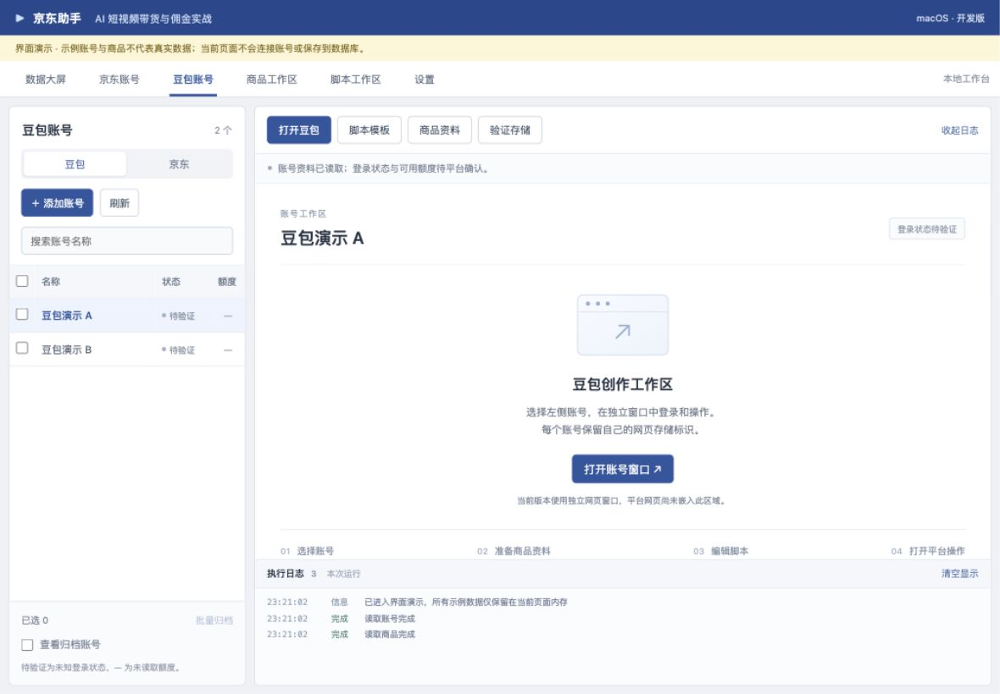

# macOS Tauri 验证版

先验证账号与网页能力，再决定是否继续采用 Tauri。目标为 macOS 14+、Apple Silicon 优先。当前代码为开发预览，不是完整带货软件。

## 启动

在项目根目录可直接执行：

```bash
make install
make dev
```

`make dev`、`make server` 也是同一个启动入口；组合执行只启动一次。Tauri 会同时启动 Vite 热更新服务。`make web` 仅启动前端服务，地址为 `http://127.0.0.1:1420`；账号、商品及脚本的本地存储功能需要桌面环境。

根目录和 `desktop/` 目录都支持 `make dev`、`make web`。启动前会检查 `1420`，自动向占用该端口的进程发送 SIGTERM，等待端口释放后启动，不限于本项目的 Vite。进程号会显示在终端；约 1.5 秒后仍占用端口时，对原占用进程发送 SIGKILL。若端口仍未释放或无权结束进程，启动失败并报告错误。不会自动换端口，因为 Tauri 的开发地址固定为 `1420`。

启动回归检查：在 `desktop/` 中执行 `npm run test:startup`，覆盖空闲端口、清理本项目 Vite、清理其他程序、强制结束忽略 SIGTERM 的进程和无效端口。`node scripts/start-dev.mjs desktop --check` 只清理并检查端口，不启动桌面应用。

准备 Node.js（符合锁定 Vite 版本要求）、Rust 工具链及 Xcode Command Line Tools，在 `desktop/` 目录执行。本次构建使用 Node 26.8.1 与 Rust 1.91.1，依赖版本见锁文件。

```bash
npm ci
npm run desktop
```

仅检查前端构建：`npm run build`。Rust 检查：`cargo test --manifest-path src-tauri/Cargo.toml`。生成未签名开发应用：`npm run tauri -- build --bundles app`。签名、公证与 DMG 尚未配置。

## 工作台布局

参考原软件的操作密度，界面整合为顶部模块导航、左侧账号列表、右侧快捷操作与内容区、底部执行日志。支持账号搜索、全选、多选、批量归档恢复，以及打开账号网页和存储验证页。商品和脚本模块首次访问时读取数据，切换模块保留当前编辑内容。

账号窗口每两秒检查可见登录提示，主窗口自动同步“已登录 / 未登录 / 待验证”并记录状态变化。可见“登录成功”或“退出登录”等明确提示时标为已登录；豆包也识别已实测的“体验套餐”账号标记与同源云盘链接组合；出现扫码或密码登录提示时标为未登录，无法识别、窗口关闭或超过十秒无响应时回到待验证。嵌入登录框的状态也会汇总，但隐藏登录框不参与判断。此状态来自页面提示，不代表服务端授权或额度验证；额度仍显示“—”。平台网页继续在独立窗口中打开，右侧区域明确说明此行为。数据大屏只展示当前读取的账号和商品数量，未接入佣金和提现。

执行日志显示本次运行最近 300 条结果，可收起和清空显示，暂不持久保存。批量归档逐账号处理，部分失败会分别记录并显示成功 / 失败数量。

仅查看界面可运行 `make web`，打开 `http://127.0.0.1:1420/?preview=1`。这是开发模式专用演示，示例账号和商品只保留在页面内存，刷新后重置，不读取真实数据库。演示支持账号列表交互；真实平台窗口、商品写入和脚本保存必须在 Tauri 中执行。正式构建不会启用该预览模式。



## 可验证内容

添加两个同平台账号，每个账号分配稳定 UUID。打开“验证存储隔离”，分别保存不同标记，关闭窗口或重启应用后检查是否保留且不串号。探针只验证 localStorage，不能代替真实平台登录验证。

“打开网页”创建独立平台窗口，由用户自行登录、生成、下载或上传；本版不采集密码，不自动消耗额度或发布。导航只允许已配置的平台 HTTPS 域名，未知登录跳转可能被阻止，需要记录后核实。平台允许域名及其 blob 视频地址可打开独立预览弹窗，其他弹窗仍被拦截。账号窗口和预览弹窗均接入原生下载：保存到系统下载目录下 `JD Affiliate/<唯一标识>/<平台文件名>`，避免覆盖已有文件。主窗口显示下载结果与“在 Finder 中显示”；下载历史以原子替换方式保存到应用数据目录的 `downloads.json`，保留最近 100 条及仍在进行中的下载；文件不会随退出删除。重启时将未完成下载标为失败，不自动续传。历史损坏或来自更新版本时保留原文件并提示错误，避免覆盖。支持在 QuickTime Player 中播放 MP4/MOV/M4V，文件移动或删除后会明确提示。旧版仅存于内存的记录不能自动恢复，旧视频文件仍在原下载目录。macOS 下载完成回调不返回路径，因此沿用下载开始时分配的路径并确认文件存在。豆包实际视频按钮、跨域 CDN、blob 下载和真实登录恢复仍需在已登录会话中实测。登录状态不写入数据库，重启后会在打开账号窗口时重新检测。

登录检测回归检查：`npm run test:login`，覆盖扫码成功、隐藏提示、退出登录和未知页面。

账号名称、平台、UUID 和归档状态保存在应用数据目录下的 `accounts.sqlite3`，WebKit 会话由操作系统持久化。首次启动会事务性导入旧验证版 localStorage 中的账号，保留原 UUID 和旧数据副本；失败时整批回滚并显示错误。已迁移数据不会因重复启动被重新导入或取消归档。

支持账号归档与恢复，归档前需关闭该账号的网页及验证窗口。归档保留登录数据和原存储标识；本版没有永久删除登录数据的功能。数据库检查不代表平台登录状态已验证。

当前尚未提供凭据备份或完整业务数据恢复功能，勿将此预览版当作正式账号存档工具。

## 商品工作区

切换到“商品工作区”，可录入和编辑 SKU、标题、京东 HTTPS 链接、规格及事实卖点，支持搜索 SKU、标题和规格。链接可留空；本版只检查格式与域名，不联网抓取商品，也不验证卖点真实性或商品链接与 SKU 的实际对应关系。

批量导入使用 UTF-8 CSV，可参考 [示例文件](examples/products.csv)。示例 SKU 与文字均为占位资料，需替换为真实商品。

1. 准备 `sku,title,url,specs,selling_points` 五列表头，顺序可以调整；列名区分大小写。
2. 选择 CSV 或粘贴内容，点击“预览检查”。含逗号、引号或换行的字段使用标准 CSV 引号转义。
3. 核对逐行结果，修正重复 SKU、空标题或链接格式错误。
4. 全部通过后点击“确认导入”。最多 500 个商品、1 MiB；任意一行失败都不会写入本批商品。

导入不覆盖已有 SKU。预览后提交时仍会重新检查数据库，防止并发操作覆盖数据。编辑保存带有版本检查，遇到冲突请保留当前编辑内容，重新读取商品并核对后再保存。

当前数据库版本为 v3。由 v1 或 v2 升级时，应用会先通过 SQLite 备份接口在数据库旁的 `backups/` 中保存升级前副本，再事务性补齐商品和脚本版本表。备份失败会阻止升级；备份仅包含业务数据库，不含 WebKit 会话。当前未提供一键恢复界面，需要恢复时先退出应用并核对版本。

## 脚本工作区

1. 先保存商品，再切换到“脚本工作区”；如刚录入新商品，点击“重新读取商品”。
2. 选择商品与服装、大物件或通用四镜头模板，点击“填入商品资料并生成草稿”。这是本地模板组装，不调用模型、不生成视频、不消耗豆包额度。
3. 核对标题、规格与事实卖点后编辑正文。资料缺失时模板会提示缺口，不自动补造参数、效果或体验。
4. 点击“保存为新版本”，保存正文、商品资料快照、商品版本与模板版本。历史记录只读；查看历史不会覆盖当前草稿。
5. 保存后修改正文可再次保存为新版本。未修改正文时再次保存只核对同一请求，不重复创建历史记录。

编辑草稿期间锁定商品和模板选择，需先保存或明确放弃草稿再切换。未保存正文仅保留在当前应用内存中，退出应用会丢失。如果商品资料在另一个工作区发生变化，旧草稿保存会被阻止，请先保留正文、重新核对商品并生成新草稿。历史版本仍保留原资料，不随商品编辑改变。

每个模板当前版本为 v1，默认 15 秒、9:16。脚本中的商品图片核对、口播及 AI 标识仍需人工处理；本版不自动读取商品图片，也不承诺生成效果。

## 构建空间

开发与测试配置关闭完整调试符号和增量缓存，并统一 macOS 部署目标为 14.0，减少重复原生编译产物。需要深入 Rust 调试时可自行调整 profile。`src-tauri/target/` 为可再生构建目录，不包含业务数据库；应用数据和 WebKit 会话独立保存。

## 回退边界

React 界面通过 `src/accounts.ts` 服务调用账号与平台窗口，不依赖 WebKit 实现细节；如需 Electron，保留界面、SQLite 数据结构与验收用例，替换桌面桥接与会话管理。不存在已完成的 Electron 代码可直接恢复，回退需要实现该适配层。

详细记录见 [平台验证记录](../docs/platform-validation.md)。

下载持久化验收：打开“验证存储”，点击“下载测试文件”，确认主窗口显示已保存；重启应用后记录应仍在，并可在 Finder 中定位。真实视频可在下载记录点击“播放视频”。

## 视频素材库

“视频素材”集中展示下载历史，支持搜索文件名、关联商品名称和 SKU，按来源账号、下载状态、是否关联商品筛选。新版下载按账号 UUID 区分同名账号；旧记录仅有账号名称，显示“旧版记录，账号未区分”，不猜测归属。

先在“商品工作区”保存商品，再进入“视频素材”，为已保存素材选择关联商品；选择“未关联商品”可解除。关联自动保存，记录选择时的商品名称、SKU 和版本，重启后保留；修改商品不会改写已有标签。可点击“重新读取商品”获取最新列表。并发修改会阻止覆盖，保存失败时保留原关联。

素材库继续支持播放与 Finder 定位。下载状态变化仍会写入全局执行日志。

## 发布准备

在“视频素材”中点击视频的“发布准备”，选择目标平台、填写标题和文案，点击“保存草稿”。未填完整也可以保存；界面会提示缺少视频文件、关联商品、平台、标题或文案。本地资料齐全只代表可以开始人工核对，不表示目标平台已审核或发布。

保存后可以复制标题和文案，到目标平台手动填写。草稿与视频关联、重启后保留；后台刷新不会覆盖正在输入的内容，其他窗口修改草稿时会阻止旧版本覆盖。关闭未保存的编辑需明确选择“放弃修改并关闭”。标题 120 字、文案 5000 字是本地草稿容量，不是各平台的发布规则。

下载历史格式升级到 v2，兼容读取 v1；保存新数据后旧版应用将拒绝覆盖新版历史。

## 开发实例与打包应用

编写代码时使用 `make dev server`。本项目的开发启动器仍在运行时，重复执行会复用已有开发环境，不清理它正在使用的端口；其他进程占用 1420 时仍会按前述逻辑释放端口。

应用接入 Tauri 官方 single-instance 插件：新版开发实例与新版打包应用共享应用标识，重复启动时显示并聚焦已有主窗口。先启动的实例继续运行，因此若当前是打包应用，请先退出再启动开发模式，才能看到代码更新。旧版未接入单实例的应用需要手动退出一次。窗口标题与右上角会明确显示“开发模式 · 代码自动更新”或“打包应用”。

## 导出发布资料包

在“视频素材”中先保存发布草稿，再点击“导出资料包”。导出到系统下载目录的 `JD Affiliate 发布资料包/发布资料包-<唯一标识>/`，包含视频副本、`发布文案.txt`、`商品摘要.json`、`资料清单.json` 与 `使用说明.txt`。商品摘要沿用关联时的名称、SKU 和版本，不读取新商品资料替换旧标签。

资料不完整也可以导出，使用说明和清单会列出缺项。导出采用保存时的草稿与商品关联快照，旧版本请求会被拒绝；复制在后台运行，失败时清理本次临时目录。每次导出使用新文件夹，原视频和已有资料包保留。导出完成后可点击“打开上次资料包”；该快捷入口仅保留本次运行，资料包文件一直保存在下载目录。

## 状态同步

快捷操作栏和视频素材库的“同步状态”会同时刷新账号与素材状态，并请求已打开的账号窗口重新检测登录。主窗口获得焦点时也会刷新，后台每两秒读取一次状态；请求串行执行，避免重复轮询覆盖新状态。素材库和数据大屏显示最后同步时间或同步错误。

豆包在本页已确认登录后，收起侧栏仍可识别保留的账号资料；仅隐藏模板不会建立登录状态，明确登录提示会覆盖旧账号标记。视频 blob 预览、下载和被阻止的导航不再清空登录状态；页面真正重新加载时重新确认，窗口关闭后回到待验证。

数据大屏同步已确认登录账号、可访问的已保存视频、发布草稿与资料齐全待人工核对数量。文件移走或删除后，素材记录显示“文件缺失”，发布准备也提示缺少视频。这里只同步本地下载及准备进度，不读取平台实际发布结果。

账号名称旁的“编辑”可修改名称；账号工作区也提供“编辑账号”入口。保存后列表及已打开窗口的标题更新，账号 UUID、平台、归档状态与登录存储不变。名称限制为 1–60 个字符；旧名称已被其他操作更新时会阻止覆盖，需刷新后重试。
